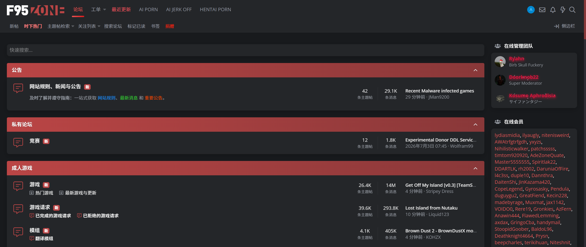
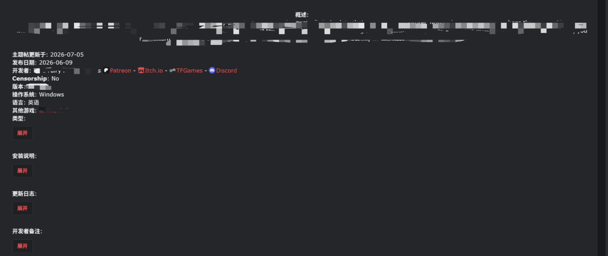

# F95zone 汉化脚本

一个基于 [TamperMonkey](https://www.tampermonkey.net/) 的 F95zone 定向翻译脚本，将网站界面中的英文文本替换为中文，辅助中文用户浏览。

## 功能

本脚本目前翻译了以下内容：

- **导航与 UI**：顶部导航栏、侧边栏、按钮、tooltip 提示、页脚链接
- **论坛版块**：版块名称、版块描述、版块统计（主题帖数/消息数）
- **帖子列表**：置顶/普通分隔符、状态徽章（已锁定/置顶/投票）、回复/查看统计
- **游戏帖子主楼**：信息字段标签及对应值
- **时间显示**：相对时间和绝对时间
- **弹窗与面板**：举报、样式选择、语言选择、个人资料卡片
- **SAM Alpha 页面**：筛选面板、游戏标签、引擎名称、Settings 面板、分页导航
- **论坛名称**：覆盖主流分区和常见子版块

> 这是一个个人项目，目前仅翻译了自己常用板块的内容，并非 100% 覆盖。翻译会逐步更新和完善。

## 安装

### 1. 安装 TamperMonkey 扩展

| 浏览器 | 安装地址 |
|--------|---------|
| Chrome / Edge | [Chrome 网上应用店](https://chromewebstore.google.com/detail/tampermonkey/dhdgffkkebhmkfjojejmpbldmpobfkfo) |
| Firefox | [Firefox 附加组件](https://addons.mozilla.org/firefox/addon/tampermonkey/) |
| Safari | [Mac App Store](https://apps.apple.com/app/tampermonkey/id1482490089) |

> TamperMonkey（油猴）是一款浏览器用户脚本管理器。安装后，你可以安装各种用户脚本来增强网页功能。

### 2. 安装翻译脚本

点击下方链接，TamperMonkey 会自动弹出安装窗口，点击 **安装** 即可：

**[→ 一键安装脚本](https://github.com/CharlenaK/f95zone-zh-cn/raw/main/f95_script.user.js)**

安装完成后，访问 [F95zone](https://f95zone.to/) 即可看到中文界面。

### 3. 更新脚本

脚本内置三级字典加载机制：

1. **CDN 热更新**：每次启动时异步从 [jsDelivr CDN](https://cdn.jsdelivr.net/gh/CharlenaK/f95zone-zh-cn@main/f95_dict.json) 拉取最新字典，版本号高于缓存时自动更新，下次加载即生效
2. **本地缓存**：更新后的字典会写入 TamperMonkey 本地存储，后续优先使用缓存
3. **内置兜底**：CDN 请求失败或超时（5s）时，回退使用脚本内置的默认字典，不影响正常使用

如需要手动更新脚本本体，可在 TamperMonkey 管理面板中点击「检查更新」。

## 项目结构

| 文件 | 说明 |
|------|------|
| `f95_script.user.js` | 主脚本，包含双引擎翻译逻辑和内置默认字典 |
| `f95_dict.json` | 独立字典文件，与脚本内置字典保持同步 |

## 反馈与贡献

- **问题反馈**：如遇到卡顿、显示错误、未翻译的内容，请在 [Issues 页面](https://github.com/CharlenaK/f95zone-zh-cn/issues) 提交
- **贡献翻译**：欢迎通过 [Pull Request](https://github.com/CharlenaK/f95zone-zh-cn/pulls) 补充词条或修复问题

### 贡献方式

1. Fork 本仓库
2. 在 `f95_dict.json` 中按现有格式添加或修改翻译词条
3. 同时更新 `f95_script.user.js` 中的 `DEFAULT_DICT` 对象，保持二者一致
4. 提交 Pull Request

---

> **声明**：本项目大部分代码由 AI 辅助生成。如果你对 AI 生成的代码有顾虑，请自行评估后使用。
